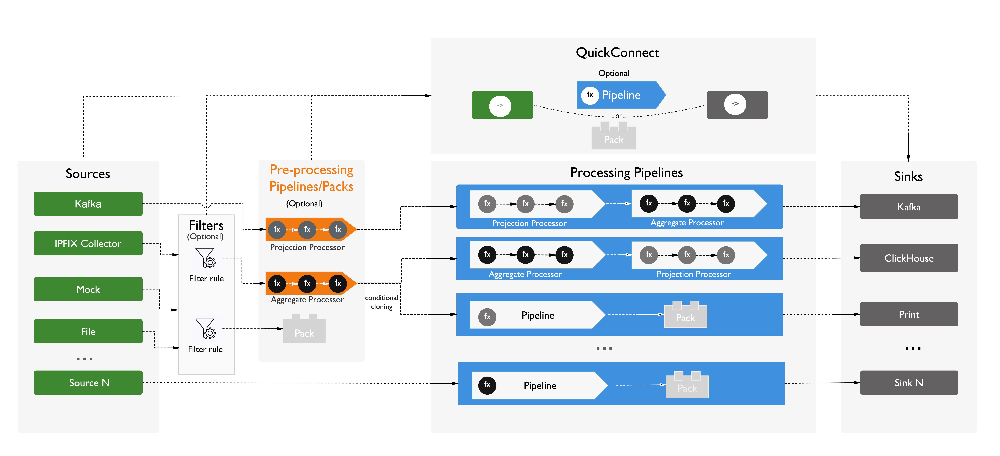

# Groot Stream 设计方案

# 目录
- [概述](#概述)
- [系统架构](#系统架构)
- [全局配置 grootstream.yaml](#全局配置-grootstreamyaml)
- [任务配置](#任务配置)
  - [接入数据源(Sources)](#接入数据源sources)
    - [Source 公共配置](#source-公共配置)
    - [Schema配置](#schema配置)
      - [Fields](#fields)
      - [Local File](#local-file)
      - [URL](#url)
    - [Kafka Source](#kafka-source)
    - [IPFIX Collector(UDP)](#ipfix-collectorudp)
    - [File Source](#file-source)
    - [Mock Source](#mock-source)
    - [Inline Source](#inline-source)
  - [过滤器(Filters)](#过滤器filters)
  - [分流器(Splits)](#分流器splits)
  - [任务处理器 (Processors)](#任务处理器-processors)
    - [Projection Processor](#projection-processor)
    - [Aggregate Processor](#aggregate-processor)
    - [Table Processor](#table-processor)
  - [输出Sinks](#输出sinks)
    - [Kafka Sink](#kafka-sink)
    - [ClickHouse Sink](#clickhouse-sink)
    - [Print Sink](#print-sink)
  - [Formats](#formats)
    - [JSON](#json)
    - [MessagePack](#messagepack)
    - [Protobuf](#protobuf)
    - [Raw](#raw)
  - [任务编排](#任务编排)
  - [函数定义](#函数定义)
    - [内置UDF](#内置udf)
      - [标量函数](#标量函数)
      - [聚合函数](#聚合函数)
      - [表格函数](#表格函数)
    - [CN扩展UDF](#cn扩展udf)
  - [实现原则](#实现原则)
  - [相关问题](#相关问题)

# 概述
Groot Stream 是一个实时数据流处理平台，提供了灵活的数据定制管道，能够高效的从多种数据源收集数据，并对其进行加工和转换。具体包括过滤、解析、重组和数据聚合，以便更好的处理和管理数据。

主要优势：

- 实时数据处理：利用Flink作为底层引擎，可以针对大规模实时数据流提供高吞吐、低延迟的实时处理能力。
- 插件化管理：可自定义Functions, Packs, Sources 和Sinks，用于满足不同应用场景下的数据流定制需求。
- 降低开发成本：通过YML模版定制数据处理拓扑，无需编写代码快速实现ETL需求。替代现有Real-time Log Streaming ，Data Transporter ETL 和Gohangout数据加载模块。

应用场景：

- 数据汇聚场景
  - 构建QuickConnect拓扑，各个分中心数据被集中汇聚到国家中心。
- 数据流定制
  - 会话日志经过预处理后发给不同的系统或第三方厂商。
    - 定义Filter 匹配符合条件的日志，然后预处理Pipeline对日志进行反序列化，增加处理时间，抽取域名等操作。
    - Router A 经过 TSG Projection处理器，执行ID-Mapping映射Subscriber ID，发送到TSG系统中。
    - Router B 经过CN Projection处理器，增加IoC标签库映射字段，删除不需要的字段，发送到CN系统中。
    - Router C 经过第三方厂商 Projection处理器，过滤SSL、HTTP 日志，抽取部分字段发送到第三方厂商中。
  - 将会话日志按应用层协议分流，分发到不同Topic中。
    - 过滤匹配SSL日志，分发到SSL Topic。
    - 过滤匹配邮件日志，分发到Email Topic。
- 数据聚合

# 系统架构

- **Sources**
  - 接收多种数据源或收集器的连续数据输入， 包括Kafka、IPFIX Collector 或UDP 等。
  - 配置参数包括基础配置和Source配置。例如Type 为Kafka，则需要增加Source参数kafka.bootstrap.servers, topics和kafka.consumer.group.id 等。
- **Filters**
  - 对数据源中的日志进行筛选和过滤，缩小处理日志的范围。
  - 通过定义过滤表达式，指定数据中某些属性、条件或规则，基于该表达式匹配符合条件的数据。例如：common_c2s_bytes_num <= 2147483647 && common_s2c_bytes_num<= 2147483647 ，过滤掉不符合Integer取值范围的数据。

- **QuickConnect**
  - 基于最小化配置，快速构建Sources和Sinks之间的数据管道，可用于原型、测试或跨域数据汇聚。
  - 通过在管道中插入Processors 或Pack。

- **Pipelines**
  - 在数据流的不同处理阶段可以引用不同类型的Pipelines，所有Pipelines(一系列Functions组成)架构和内部结构一致，只分为Projection和Aggregate两种类型。按Pipeline所在数据流的位置可分为：
    - **Pre-processing Pipelines ：可选，**前处理数据管道对输入日志进行格式化或执行一系列全局处理函数（例如：从原始日志中提取感兴趣的字段）。
    - **Processing Pipelines：**业务处理管道
    - **Post-processing Pipelines ，可选，**后处理数据管道，发送到目的地之前对日志进行格式化或执行一系列全局处理函数（例如：对输出的日志进行格式验证、类型转换）
  - 数据流处理基本单元为处理器，按功能分为无状态和有状态处理器。每个处理器可以连接多个函数，组成一个Pipeline。
    - 投影处理器(Projection Processor)：针对每条日志选择所需的列或属性。它属于无状态处理器，期间会严格按照处理器定义的函数(UDFs)顺序执行。例如：获取顶级域名，字符串转换、类型转换或反序列化等运算符函数组成一个Pipeline。
    - 聚合处理器(Aggregate Processor)：多条日志进行分组聚合统计。它属于有状态处理器，期间可经过一系列自定义聚合函数(UDAFs)。例如：计算不同IP的总带宽，不同域名总会话数等聚合函数组成一个Pipeline。
    - 表格处理器(Table Processor)：一条日志展开为多条输出。它属于无状态处理器，期间可经过一系列自定义聚合函数(UDTFs)。例如：将某个JSON格式的属性展开为多条，其他属性复制，将多条日志输出。
- **Sinks**
  - 发送数据到多个目的地， 具体包括Kafka、HBase 或 Mysql 等。 
  - 每种Sink包括基础配置和Sink配置。例如Type 为Kafka，则需要Sink参数Kafka.bootstrap.servers, kafka.topic和kafka.producer.ack 等。
- **Packs**
  - 复杂业务逻辑处理器，一般应用于无法通过函数实现的场景。例如：动态知识库加载及动态schema的数据序列化。

# 全局配置 grootstream.yaml

```yaml
grootstream:
# 知识库配置
  knowledge_base:
    - name: tsg_ip_asn # 知识库名称
      fs_type: http  # 文件系统类型（http,local,hdfs..）
      fs_path: http://127.0.0.1:9999/v1/knowledge_base # 文件路径（单机模式hdfs://{ip}:{port}/{path}，集群模式hdfs://{nameservice}/{path}）  
      files:
        - f9f6bc91-2142-4673-8249-e097c00fe1ea  # 知识库文件名
        # ....
        
    - name: tsg_ip_location
      # ....
  kms:
    local:
      type: local
    vault:
      type: vault
      url: <vault-url>
      token: <vault-token>
      default_key_path: <default-vault-key-path>
      plugin_key_path: <plugin-vault-key-path>
  ssl:
    enabled: false
    cert_file: <certificate-file>
    key_file: <private-key-file>
    require_client_auth: false
   
  properties:   # 用户自定义属性的支持从函数中获取，使用方式见函数定义
    hos.path: http://127.0.0.1:9093
    hos.bucket.name.traffic_file: traffic_file_bucket
    hos.bucket.name.troubleshooting_file: troubleshooting_file_bucket
    scheduler.knowledge_base.update.interval.minutes: 1  #知识库文件定时更新时间
```

| 属性名            | 必填 | 默认值 | 类型               | 描述                                           |
|----------------| ---- | ------ | ------------------ | ---------------------------------------------- |
| knowledge_base | Y    | -      | Object             | 知识库配置                                     |
| kms            | N    | -      | Object             | kms (key management system, 密钥管理系统) 配置 |
| ssl            | N    | -      | Object             | 客户端启用SSL双向认证                          |
| properties     | N    | -      | Map(String,Object) | 自定义属性配置：key-value 格式                 |


# 任务配置

## 接入数据源(Sources)

### **Source 公共配置**

```yaml
sources:
  kafka_source:
    type : kafka   # source connector 类型
    # source表schema, 通过fields/local_file/url三种方式配置: 配置则转换校验, 只输出配置的列；没配置输出全部列, 不进行类型转换和校验
    schema:
      fields:
        - name: common_recv_time
          type: bigint
        - name: common_log_id
          type: bigint
    # local_file: "schema/test_schema.json"
    # url: "http://127.0.0.1/schema.json"
    # watermark_timestamp: recv_time
    # watermark_timestamp_unit: ms
    # watermark_lag: 60
    properties:   # source connector 配置
      prop_key1: prop_value1
      prop_key2: prop_value2
      #...
```

| 属性名                      | 必填    | 默认值       | 类型        | 描述                                                                                       |
|--------------------------|-------|-----------|-----------|------------------------------------------------------------------------------------------|
| **type**                 | Y     | -         | String    | source唯一标识                                                                               |
| schema                   | N     | -         | Map       | source表schema，配置则只输出配置的列，同时会进行类型转换和校验。                                                   |
| watermark_timestamp      | N     | -         | String    | watermark timestamp字段名称。                                                                 |
| watermark_timestamp_unit | N     | ms        | String    | watermark timestamp字段单位，可选值：ms(milliseconds),s(seconds)。如果配置watermark_timestamp，此字段是必须的。 |
| watermark_lag            | N     | -         | Long      | watermark out-of-order milliseconds。如果配置watermark_timestamp，此字段是必须的。                     |
| properties               | Y     | -         | Object    | source属性配置                                                                               |

### schema配置

支持通过fields/local_file/url三种方式配置，只能同时配置一种方式。

#### Fields

支持配置属性列表和sql风格字符串(hive sql)

example：

```yaml
  schema:
  fields:
    - name: common_recv_time
      type: bigint
    - name: common_log_id
      type: bigint
```

支持的数据类型：

| 类型      | 对应java类型              | 描述                                                                         |
|---------|-----------------------|----------------------------------------------------------------------------|
| string  | String                | 字符串                                                                        |
| int     | Integer               | int                                                                        |
| bigint  | Long                  | bigint                                                                     |
| float   | Float                 | float                                                                      |
| double  | Double                | double                                                                     |
| boolean | Boolean               | boolean                                                                    |
| binary  | byte[]                | 字节数组                                                                       |
| struct  | Map<String, Object>   | 结构体。例如：struct<id:int, client_ip:string, data:struct<id:int, name:string>>。 |
| array   | List<Object>          | 数组。例如：array<int>,  array<struct<id:int, client_ip:string>>。                |

#### Local File

读取本地文件中的schema定义，只支持tsg avro schema格式

- example

```yaml
 schema:
    local_file: "schema/test_schema.json"
```

- test_schema.json

```yaml
  {
  "type": "record",
  "name": "test",
  "fields" : [
    {"name": "log_id", "type": "long"},
    {"name": "recv_time", "type": "long"},
    {"name": "client_ip", "type": "string","doc": {"visibility": "enabled"}}
  ]
}
```

#### URL

读取http url返回的schema定义，只支持tsg avro schema格式，支持动态更新schema，支持动态schema的connector有：clickhouse sink.

example：

```yaml
  schema:
    url: "http://127.0.0.1/schema.json"
```

### Kafka Source

```yaml
sources: # [object] 
  kafka_source:  # [object] Source Name 
    # source标识
    type : kafka
    # 数据schema: 配置则转换校验, 只输出配置的列；没配置输出全部列, 不进行类型转换和校验
    fields:
      - name: common_recv_time
        type: bigint
      - name: common_log_id
        type: bigint
    # source属性配置
    properties:
      topic: SESSION-RECORD-COMPLETED
      kafka.bootstrap.servers: 192.168.44.11:9092
      kafka.session.timeout.ms: 60000
      kafka.max.poll.records: 3000
      kafka.max.partition.fetch.bytes: 31457280
      kafka.group.id: SESSION-RECORD-COMPLETED-GROUP-GROOT-STREAM-20231021
      kafka.auto.offset.reset: latest
      format: json
```

| 属性名                         | 必填 | 默认值  | 类型     | 描述                                                |
|-----------------------------|----|------|--------|---------------------------------------------------|
| **topic**                   | Y  | -    | String | Kafka Topic名称。支持 Topic列表，用分号分隔，如'topic-1;topic-2' |
| **kafka.bootstrap.servers** | Y  | -    | String | Kafka Broker 地址                                   |
| **format**                  | Y  | JSON | String | format，用来反序列化消息JSONProtobufCSV...                 |
| Kafka Properties            | N  | -    |        | kafka Consumer Properties，以"kafka."作为前缀           |
| Format properties           | N  | -    |        | format properties，以Format类型作为前缀。例如： “protobuf.”   |

### IPFIX Collector(UDP)

```yaml
sources: # [object] 
  ipfix_source:  # [object] Source Name 
    # source标识
    type : ipfix
    # 数据schema: 配置则转换校验, 只输出配置的列；没配置输出全部列, 不进行类型转换和校验
    fields:
      - name: recv_time
        type: bigint
      - name: log_id
        type: bigint
    # source属性配置
    properties:             
      port.range: 12345-12347
      max.packet.size: 65535
      max.receive.buffer.size: 104857600
      service.discovery.registry.mode: 0
      service.discovery.service.name: udp_ipfix
      service.discovery.health.check.interval: 5
      service.discovery.nacos.server.addr: 192.168.44.12:8848
      service.discovery.nacos.username: nacos
      service.discovery.nacos.password: nacos
      service.discovery.nacos.namespace: test
      service.discovery.nacos.group: IPFIX
      service.discovery.consul.server.addr: 192.168.41.30
      service.discovery.consul.server.port: 8500
      service.discovery.consul.token:
```

| 属性名                                        | 必填         | 默认值         | 类型       | 描述                                                                          |
|--------------------------------------------|------------|-------------|----------|-----------------------------------------------------------------------------|
| port.range                                 | Y          | -           | String   | IPFIX Collector的UDP端口，指定单个端口或端口范围。例如指定单个端口为4739，指定端口范围为12345-12347。         |
| max.packet.size                            | N          | 65535       | Integer  | 单条UDP数据包的最大大小，最大值为65535(Bytes)。                                             |
| max.receive.buffer.size                    | N          | 104857600   | Integer  | UDP接收缓存区大小(Bytes)。                                                          |
| service.discovery.registry.mode            | N          | -           | Integer  | 服务发现的注册模式，0为nacos，1为consul，其他为不使用服务发现。                                      |
| service.discovery.service.name             | N          | -           | String   | 服务发现中的serviceName。                                                          |
| service.discovery.health.check.interval    | N          | -           | Integer  | 服务发现健康检查的时间间隔，单位秒。                                                          |
| service.discovery.nacos.server.addr        | N          | -           | String   | nacos服务的地址，格式为ip:port， service.discovery.registry.mode为0时必须指定。              |
| service.discovery.nacos.username           | N          | -           | String   | nacos的用户名，service.discovery.registry.mode为0时必须指定。                           |
| service.discovery.nacos.password           | N          | -           | String   | nacos的密码，service.discovery.registry.mode为0时必须指定。                            |
| service.discovery.nacos.namespace          | N          | -           | String   | nacos中的命名空间，service.discovery.registry.mode为0时可设置，不设置为public。               |
| service.discovery.nacos.group              | N          | -           | String   | nacos中的所属组，service.discovery.registry.mode为0时可设置，不设置为DEFAULT。               |
| service.discovery.consul.server.ip         | N          | -           | String   | consul服务的ip，service.discovery.registry.mode为1时必须指定。                         |
| service.discovery.consul.server.port       | N          | -           | Integer  | consul服务的端口，service.discovery.registry.mode为1时必须指定。                         |
| service.discovery.consul.token             | N          | -           | String   | consul的token，service.discovery.registry.mode为1且consul开启验证时必须指定。             |

### File Source

从text file读取数据，支持本地文件和hdfs文件，用于测试以及从文件回放数据，这个source每个1s发送2条数据

```yaml
sources:
  file_source:
    type: file
    properties:
      # path: 'hdfs://ns1/test/logs.json'
      path: './logs.json'
      rows.per.second: 2
      format: json
```

| 属性名                       | 必填    | 默认值  | 类型      | 描述                                                                                                                                          |
|---------------------------|-------|------|---------|---------------------------------------------------------------------------------------------------------------------------------------------|
| **path**                  | Y     | -    | String  | 文件路径，以[hdfs://](hdfs://ns1/test/logs.json)开头为hdfs文件，其它为本地文件系统文件。例如：./logs/logs.json, [hdfs://ns1/test/logs.json](hdfs://ns1/test/logs.json) |
| **format**                | Y     | -    | String  | 使用的format                                                                                                                                   |
| rows.per.second           | N     | 1000 | Integer | 每秒生成行数                                                                                                                                      |
| number.of.rows            | N     | -1   | Long    | 总生成行数，默认此source是无界流(会循环从文件生成数据)，当配置大于0时此source为有界流                                                                                          |
| millis.per.row            | N     | 0    | Long    | 每行生成花费毫秒数，当大于0时，rows.per.second配置不生效                                                                                                        |
| read.local.file.in.client | N     | true | Boolean | 是否在客户端读取本地文件，客户端读取限制文件大小最大为128MB。当为false时，在taskmanager端读取文件，必须在每个taskmanager的path存放文件                                                       |

put file to hdfs:

```shell
# maka dir
hadoop fs -mkdir hdfs://ns1/test
 
# put local file to hdfs
hadoop fs -put logs.json hdfs://ns1/test
 
# list hdfs dir
hadoop fs -ls logs.json hdfs://ns1/test
```

### **Mock Source**

mock数据源，用于生成测试数据

```yaml
sources:
  mock_source:
    type : mock
    properties:
      mock.desc.file.path: './mock_example.json'
      rows.per.second: 1
```

| 属性名                       | 必填  | 默认值   | 类型      | 描述                                                 |
|---------------------------|-----|-------|---------|----------------------------------------------------|
| **mock.desc.file.path**   | Y   | -     | String  | mock schema文件路径                                    |
| rows.per.second           | N   | 1000  | Integer | 每秒生成行数                                             |
| number.of.rows            | N   | -1    | Long    | 总生成行数，默认此source是无界流(会循环从文件生成数据)，当配置大于0时此source为有界流 |
| millis.per.row            | N   | 0     | Long    | 每行生成花费毫秒数，当大于0时，rows.per.second配置不生效               |

#### mock desc 文件配置

mock desc为json配置，配置每个字段的mock规则，格式：

```json
 [
  {
    "name": "field_name1",
    "type": "type1",
    "arg": "arg"
  },
   {
    "name": "field_name2",
    "type": "type2",
    "arg": "arg"
  }
  
]
```


#### mock type

| type            | 参数                                                                                                                                                                  |                                           说明                                           | 返回数据类型                                          | 例子                                                                                                                                                                                                                                                                                                                                                   |
|:----------------|:--------------------------------------------------------------------------------------------------------------------------------------------------------------------|:--------------------------------------------------------------------------------------:|-------------------------------------------------|------------------------------------------------------------------------------------------------------------------------------------------------------------------------------------------------------------------------------------------------------------------------------------------------------------------------------------------------------|
| Number          | min(number)：range起始值(包含)，默认：0。max(number)：range结束值(不包含)，默认：int32.max。options(array<number>)：number列表，配置options则[start, end)失效，默认：null。random(boolean)：随机模式，默认：true。 |                                       用于生成number                                       | 根据start、end、options的值，推测返回类型为：int或bigint或double | 随机生成[0, 10000)范围的int数据：{"name":"int_random","type":"Number","min":0,"max":10000}递增方式生成[0, 10000)范围的int数据：{"name":"int_inc","type":"Number","min":0,"max":10000,"random":false}从int列表生成int数据：{"name":"int_options","type":"Number","options":[20,22,25,30]}随机生成[0, 10000)范围的double数据：{"name":"double_random","type":"Number","min":0.0,"max":10000.0} |
| Sequence        | start(bigint)：range起始值(包含)，默认：0。step(bigint)：步长，默认：1。                                                                                                               |                                  用于生成bigint序列, 类似等差数列                                  | bigint                                          | 生成0,1,2...序列：{"name":"sub_id","type":"Sequence","start":0}生成0,2,4...序列：{"name":"sub_id","type":"Sequence","start":0,"step":2}                                                                                                                                                                                                                        |
| UniqueSequence  | start(bigint)：range起始值(包含)，默认：0。                                                                                                                                    |  用于生成唯一bigint序列，0,1,2...和Sequence的区别：  Sequence每个线程单独生成序列  UniqueSequence生成数字整个程序保证唯一  | bigint                                          | 生成0,1,2...序列：{"name":"id","type":"UniqueSequence","start":0}                                                                                                                                                                                                                                                                                         |
| String          | regex(string)：根据正则随机生成符合正则的字符串，默认：[a-zA-Z]{0,5}。options(array`<string>`)：string列表，配置options则regex失效，默认：null。random(boolean)：随机模式，默认：true。                           |                                       用于生成string                                       | string                                          | 随机生成长度我5-10的小写英文字符串：{"name":"str_regex","type":"String","regex":"[a-z]{5,10}"}从string列表生成string数据：{"name":"str_options","type":"String","options":["a","b","c"]}                                                                                                                                                                                     |
| Timestamp       | unit(string)：second或millis，生成秒或者毫秒时间戳，默认：second。                                                                                                                    |                                     用于生成时间戳(当前时间)                                      | bigint                                          | 生成unix时间戳：{"name":"timestamp","type":"Timestamp"}生成毫秒时间戳：{"name":"timestamp_ms","type":"Timestamp","unit":"millis"}                                                                                                                                                                                                                                  |
| FormatTimestamp | format(string)：format，默认：yyyy-MM-dd HH:mm:ss。utc(boolean)：使用utc时区，默认：false，当地时区。                                                                                    |                                    用于生成时间字符串(当前时间)                                     | string                                          | 生成时间字符串：{"name":"timestamp_str","type":"FormatTimestamp","format":"yyyy-MM-dd HH:mm:ss"}生成时间字符串：{"name":"timestamp_str","type":"FormatTimestamp","format":"yyyy-MM-dd HH:mm:ss.SSS"}                                                                                                                                                                 |
| IPv4            | start(string)：起始值ip(包含)，默认：0.0.0.0。end(string)：结束ip(包含)，默认：255.255.255.255。                                                                                         |                                  用于生成start-end范围的ip地址                                  | string                                          | 随机生成192.168.20.1-192.168.20.255范围的ip地址：{"name":"ip","type":"IPv4","start":"192.168.20.1","end":"192.168.20.255"}                                                                                                                                                                                                                                     |
| Expression      | expression(string)：Datafaker expression，默认：null。                                                                                                                    | 用于使用datafaker库的expression生成随机字符串文档：https://www.datafaker.net/documentation/expressions | string                                          | 生成人名：{"name":"name","type":"Expression","expression":"#{[Name.name](http://Name.name)}"}生成邮箱地址：{"name":"emailAddress","type":"Expression","expression":"#{internet.emailAddress}"}                                                                                                                                                                   |
| Hlld            | itemCount(bigint)：总基数(总唯一元素数量)，默认：1000000。batchCount(int)：每次生成的hll随机添加的元素数量，默认：10000。precision(int)：hll的精度，范围[4, 18]，默认：12。                                         |                               用于生成Hlld Sketch，hll算法的一种实现                               | string(字节数组的base64)                             | 生成ip hll 每次大约包含1000个ip：{ "name": "ip_cnt", "type": "Hlld", "itemCount": 100000, "batchCount": 1000 }                                                                                                                                                                                                                                                 |
| HdrHistogram    | max(bigint)：histogram最大值，默认：100000。batchCount(int)：每次生成的histogram随机添加的元素数量，默认：1000。numberOfSignificantValueDigits(int)：histogram的精度，范围[1, 5]，默认：1。                  |                     用于生成HdrHistogram Sketch，一种分位数Histogram Sketch                      | string(字节数组的base64)                             | 生成延时的Histogram，每次包含1000个ms延时： { "name": "ms_his", "type": "HdrHistogram", "max": 100000, "batchCount": 1000}                                                                                                                                                                                                                                         |
| Eval            | expression(string)：AviatorScript expression，默认：null。                                                                                                                |      计算列，通过其它列计算值AviatorScript文档：https://www.yuque.com/boyan-avfmj/aviatorscript       | 返回类型依赖expression，可能为任何类型                        | 根据已有的in_bytes(bigint), out_bytes(bigint)列计算bytes(bigint)列其值为其它两个的和：{"name": "bytes", "type": "Eval", "expression": "in_bytes + out_bytes"}                                                                                                                                                                                                           |
| Object          | fields(array)：每个字段的生成规则，可以使用所有type，默认：null。                                                                                                                         |                用于生成struct/object类型fields内容和mock desc文件根配置一样，描述每个字段的生成规则                | struct/object                                   | 生成object：{"name":"object","type":"Object","fields":[{"name":"str","type":"String","regex":"[a-z]{5,10}","nullRate":0.1},{"name":"cate","type":"String","options":["a","b","c"]}]}                                                                                                                                                                    |
| Union           | unionFields(array)：每组字段生成规则，默认：null。每个元素的字段：fields(array)：和Object配置一样weight(int)：此组字段权重，根据权重按照比例生成数据random(boolean)：随机模式，默认：true。                                   |                                       用于生成有关联的字段                                       | 各个字段配置类型                                        | 生成object_id、item_id字段，当object_id = 10时，item_id从[1, 2, 3, 4, 5]生成数据，当object_id = 20时，item_id从[6, 7]生成数据，第一种数据占比5/7，第二种数据占比2/7                                                                                                                                                                                                                         |

- Union 举例

```json
{
  "name": "unionFields",
  "type": "Union",
  "random": false,
  "unionFields": [
    {
      "weight": 5,
      "fields": [
        {
          "name": "object_id",
          "type": "Number",
          "options": [10]
        },
        {
          "name": "item_id",
          "type": "Number",
          "options": [1, 2, 3, 4, 5],
          "random": false
        }
      ]
    },
    {
      "weight": 2,
      "fields": [
        {
          "name": "object_id",
          "type": "Number",
          "options": [20]
        },
        {
          "name": "item_id",
          "type": "Number",
          "options": [6, 7],
          "random": false
        }
      ]
    }
  ]
}
```

type通用参数：

| 参数                      | 说明                                      | 例子                                                                                                              |
|-------------------------|-----------------------------------------|-----------------------------------------------------------------------------------------------------------------|
| nullRate(double)        | 生成数据null值比率，默认是1，没有null值。               | 随机生成字符串，null值占10%：{"name":"str_regex","type":"String","regex":"[a-z]{5,10}","nullRate":0.1}                     |
| array(double)           | 是否是数组类型，默认false。                        | 生成数组字符串：{"name":"array_str","type":"String","regex":"[a-z]{5,10}","array":true,"arrayLenMin":1,"arrayLenMax":3} |
| arrayLenMin(int)        | 数组最小长度(包含)，默认0。array属性为true时才生效。        |                                                                                                                 |
| arrayLenMax(int)        | 数组最大长度(包含)，默认5。array属性为true时才生效。        |                                                                                                                 |

#### mock 示例

**各个类型生成查看**

配置：

```json
[
  {
    "name": "id",
    "type": "UniqueSequence",
    "start": 0
  },
  {
    "name": "sub_id",
    "type": "Sequence",
    "start": 0
  },
  {
    "name": "int_random",
    "type": "Number",
    "min": 0,
    "max": 10000
  },
  {
    "name": "int_inc",
    "type": "Number",
    "min": 0,
    "max": 10000,
    "random": false
  },
  {
    "name": "int_options",
    "type": "Number",
    "options": [20, 22, 25, 30],
    "random": true
  },
  {
    "name": "int_options_round_robin",
    "type": "Number",
    "options": [20, 22, 25, 30],
    "random": false
  },
  {
    "name": "double_random",
    "type": "Number",
    "min": 0.0,
    "max": 10000.0
  },
  {
    "name": "str_regex",
    "type": "String",
    "regex": "[a-z]{5,10}",
    "nullRate": 0.1
  },
  {
    "name": "str_options",
    "type": "String",
    "options": ["a", "b", "c"]
  },
  {
    "name": "str_options_round_robin",
    "type": "String",
    "options": ["a", "b", "c"],
    "random": false
  },
  {
    "name": "timestamp",
    "type": "Timestamp"
  },
  {
    "name": "timestamp_ms",
    "type": "Timestamp",
    "unit": "millis"
  },
  {
    "name": "timestamp_str",
    "type": "FormatTimestamp",
    "format": "yyyy-MM-dd HH:mm:ss"
  },
  {
    "name": "ip",
    "type": "IpV4",
    "start": "192.168.20.1",
    "end": "192.168.20.255"
  },
  {
    "name": "array_str",
    "type": "String",
    "options": ["a", "b", "c"],
    "array": true,
    "arrayLenMin": 1,
    "arrayLenMax": 3
  },
  {
    "name": "array_object",
    "type": "Object",
    "fields": [
      {
        "name": "str",
        "type": "String",
        "regex": "[a-z]{5,10}",
        "nullRate": 0.1
      },
      {
        "name": "name",
        "type": "Expression",
        "expression": "#{Name.name}"
      },
      {
        "name": "emailAddress",
        "type": "Expression",
        "expression": "#{internet.emailAddress}"
      }
    ]
  }
]
```

生成数据：

```
{"id":0,"sub_id":0,"int_random":7604,"int_inc":0,"int_options":30,"int_options_round_robin":20,"double_random":2329.3205359759163,"str_regex":"wxzrpn","str_options":"b","str_options_round_robin":"a","timestamp":1717493414,"timestamp_ms":1717493414603,"timestamp_str":"2024-06-04 17:30:14","ip":"192.168.20.24","array_str":["b"],"array_object":{"str":"wvrzqde","name":"Berry Gorczany","emailAddress":"christopher.wintheiser@gmail.com"}}
{"id":1,"sub_id":1,"int_random":5760,"int_inc":1,"int_options":30,"int_options_round_robin":22,"double_random":9644.141255418077,"str_regex":"oadbz","str_options":"a","str_options_round_robin":"b","timestamp":1717493415,"timestamp_ms":1717493415603,"timestamp_str":"2024-06-04 17:30:15","ip":"192.168.20.127","array_str":["c"],"array_object":{"str":"bkcwtpl","name":"Alba Gottlieb","emailAddress":"ariane.jakubowski@yahoo.com"}}
{"id":2,"sub_id":2,"int_random":3775,"int_inc":2,"int_options":20,"int_options_round_robin":25,"double_random":9573.948656302768,"str_regex":"rlhtrk","str_options":"b","str_options_round_robin":"c","timestamp":1717493416,"timestamp_ms":1717493416603,"timestamp_str":"2024-06-04 17:30:16","ip":"192.168.20.20","array_str":["b"],"array_object":{"name":"Celestina O'Reilly","emailAddress":"claude.schimmel@yahoo.com"}}
{"id":3,"sub_id":3,"int_random":7877,"int_inc":3,"int_options":22,"int_options_round_robin":30,"double_random":8921.757584727951,"str_regex":"spydx","str_options":"c","str_options_round_robin":"a","timestamp":1717493417,"timestamp_ms":1717493417603,"timestamp_str":"2024-06-04 17:30:17","ip":"192.168.20.218","array_str":["a","a"],"array_object":{"name":"Dr. Nichole McGlynn","emailAddress":"donny.russel@yahoo.com"}}
{"id":4,"sub_id":4,"int_random":8248,"int_inc":4,"int_options":30,"int_options_round_robin":20,"double_random":4105.3600047674545,"str_regex":"rbjelg","str_options":"b","str_options_round_robin":"b","timestamp":1717493418,"timestamp_ms":1717493418602,"timestamp_str":"2024-06-04 17:30:18","ip":"192.168.20.146","array_str":["b"],"array_object":{"str":"ekbyer","name":"Raul Leannon","emailAddress":"donn.bechtelar@hotmail.com"}}
{"id":5,"sub_id":5,"int_random":3663,"int_inc":5,"int_options":22,"int_options_round_robin":22,"double_random":7486.737315942628,"str_regex":"qyqqiyj","str_options":"c","str_options_round_robin":"c","timestamp":1717493419,"timestamp_ms":1717493419610,"timestamp_str":"2024-06-04 17:30:19","ip":"192.168.20.90","array_str":["c","b"],"array_object":{"str":"dbepb","name":"Moshe Powlowski","emailAddress":"terina.rogahn@hotmail.com"}}
{"id":6,"sub_id":6,"int_random":6967,"int_inc":6,"int_options":22,"int_options_round_robin":25,"double_random":6742.751027323034,"str_regex":"slfghf","str_options":"a","str_options_round_robin":"a","timestamp":1717493420,"timestamp_ms":1717493420602,"timestamp_str":"2024-06-04 17:30:20","ip":"192.168.20.72","array_str":["b","b"],"array_object":{"name":"Alvera Graham","emailAddress":"thurman.lindgren@hotmail.com"}}
{"id":7,"sub_id":7,"int_random":5340,"int_inc":7,"int_options":25,"int_options_round_robin":30,"double_random":7259.505902869291,"str_regex":"yarcof","str_options":"c","str_options_round_robin":"b","timestamp":1717493421,"timestamp_ms":1717493421614,"timestamp_str":"2024-06-04 17:30:21","ip":"192.168.20.44","array_str":["a"],"array_object":{"str":"dxianwxv","name":"Pedro Kerluke","emailAddress":"jannette.bauch@yahoo.com"}}
{"id":8,"sub_id":8,"int_random":8365,"int_inc":8,"int_options":25,"int_options_round_robin":20,"double_random":7142.049302311821,"str_options":"c","str_options_round_robin":"c","timestamp":1717493422,"timestamp_ms":1717493422603,"timestamp_str":"2024-06-04 17:30:22","ip":"192.168.20.197","array_str":["b"],"array_object":{"str":"mximiyd","name":"Herman Runte","emailAddress":"thomas.gerlach@hotmail.com"}}
{"id":9,"sub_id":9,"int_random":5944,"int_inc":9,"int_options":30,"int_options_round_robin":22,"double_random":1420.8479774375382,"str_regex":"eahpq","str_options":"b","str_options_round_robin":"a","timestamp":1717493423,"timestamp_ms":1717493423602,"timestamp_str":"2024-06-04 17:30:23","ip":"192.168.20.44","array_str":["a","a","b"],"array_object":{"str":"kseeqicxuh","name":"Kaitlyn Douglas","emailAddress":"jonathon.kerluke@gmail.com"}}
{"id":10,"sub_id":10,"int_random":9357,"int_inc":10,"int_options":30,"int_options_round_robin":25,"double_random":2451.2488213660886,"str_regex":"agwxbf","str_options":"b","str_options_round_robin":"b","timestamp":1717493424,"timestamp_ms":1717493424607,"timestamp_str":"2024-06-04 17:30:24","ip":"192.168.20.19","array_str":["b","c"],"array_object":{"str":"iidogsi","name":"Luigi McClure PhD","emailAddress":"jay.aufderhar@hotmail.com"}}
```

**object类型以及Union类型生成**

配置：

```json
[
  { "name": "name", "type": "String",  "options": ["object_statistics"] },
  { "name": "timestamp_ms", "type": "Timestamp", "unit": "millis" },
  { "name": "tags", "type": "Object", "fields": [
      { "name": "vsys_id", "type": "Number", "options": [1] },
      { "name": "template_id", "type": "Number", "options": [1] },
      { "name": "chart_id", "type": "Number", "options": [1] },
      { "name": "version", "type": "Number", "options": [1] },
      { "name": "unionFields", "type": "Union", "unionFields": [
          { "weight": 2, "fields": [
              { "name": "object_type", "type": "String", "options": ["ip"] },
              { "name": "object_id", "type": "Number", "options": [7562] },
              { "name": "item_id", "type": "Number", "options": [7835, 7819] }
            ]
          },
          { "weight": 2, "fields": [
              { "name": "object_type", "type": "String", "options": ["fqdn"] },
              { "name": "object_id", "type": "Number", "options": [13087] },
              { "name": "item_id", "type": "Number", "options": [229604,229603] }
            ]
          }
        ]
      }
    ]
  },
  { "name": "fields", "type": "Object", "fields": [
      { "name": "in_bytes", "type": "Number", "min": 10000, "max": 200000},
      { "name": "out_bytes", "type": "Number", "min": 10000, "max": 200000},
      { "name": "new_in_sessions", "type": "Number", "min": 10, "max": 200},
      { "name": "new_out_sessions", "type": "Number", "min": 10, "max": 200}
    ]
  }
]
```

生成数据：

```
{"name":"object_statistics","timestamp_ms":1717573879804,"tags":{"vsys_id":1,"template_id":1,"chart_id":1,"version":1,"object_type":"ip","object_id":7562,"item_id":7819},"fields":{"in_bytes":47083,"out_bytes":68389,"new_in_sessions":142,"new_out_sessions":92}}
{"name":"object_statistics","timestamp_ms":1717573879807,"tags":{"vsys_id":1,"template_id":1,"chart_id":1,"version":1,"object_type":"fqdn","object_id":13087,"item_id":229603},"fields":{"in_bytes":81118,"out_bytes":107287,"new_in_sessions":98,"new_out_sessions":86}}
{"name":"object_statistics","timestamp_ms":1717573879808,"tags":{"vsys_id":1,"template_id":1,"chart_id":1,"version":1,"object_type":"ip","object_id":7562,"item_id":7835},"fields":{"in_bytes":61395,"out_bytes":111095,"new_in_sessions":87,"new_out_sessions":149}}
{"name":"object_statistics","timestamp_ms":1717573879808,"tags":{"vsys_id":1,"template_id":1,"chart_id":1,"version":1,"object_type":"fqdn","object_id":13087,"item_id":229603},"fields":{"in_bytes":145986,"out_bytes":12166,"new_in_sessions":169,"new_out_sessions":127}}
{"name":"object_statistics","timestamp_ms":1717573880806,"tags":{"vsys_id":1,"template_id":1,"chart_id":1,"version":1,"object_type":"fqdn","object_id":13087,"item_id":229604},"fields":{"in_bytes":112797,"out_bytes":120310,"new_in_sessions":12,"new_out_sessions":177}}
{"name":"object_statistics","timestamp_ms":1717573880806,"tags":{"vsys_id":1,"template_id":1,"chart_id":1,"version":1,"object_type":"fqdn","object_id":13087,"item_id":229604},"fields":{"in_bytes":180960,"out_bytes":118214,"new_in_sessions":106,"new_out_sessions":73}}
{"name":"object_statistics","timestamp_ms":1717573880806,"tags":{"vsys_id":1,"template_id":1,"chart_id":1,"version":1,"object_type":"ip","object_id":7562,"item_id":7819},"fields":{"in_bytes":91394,"out_bytes":105840,"new_in_sessions":74,"new_out_sessions":177}}
{"name":"object_statistics","timestamp_ms":1717573880806,"tags":{"vsys_id":1,"template_id":1,"chart_id":1,"version":1,"object_type":"ip","object_id":7562,"item_id":7835},"fields":{"in_bytes":79266,"out_bytes":95721,"new_in_sessions":50,"new_out_sessions":88}}```
```

### Inline Source

用于简单测试format，function，sink等，这个source每个1s发送一条配置的data数据

```yaml
sources:
  inline_source:
    type : inline
    fields:
      - name: log_id
        type: bigint
      - name: recv_time
        type: bigint
      - name: client_ip
        type: string
    properties:
      # 单条数据
      data: '{"log_id": 1, "recv_time":"111", "client_ip":"192.168.0.1"}'
      # 多条数据
      # data: '[{"log_id": 1, "recv_time":"111", "client_ip":"192.168.0.1"}, {"log_id": 2, "recv_time":"222", "client_ip":"192.168.0.2"}]'
      # data: '["1,111,192.168.0.1", "2,222,192.168.0.2"]'
      format: json
      json.ignore.parse.errors: false
```

| 属性名               | 必填 | 默认值    | 类型       | 描述                                                |
|-------------------|----|--------|----------|---------------------------------------------------|
| **data**          | Y  | -      | String   | source发送的数据，如果是json array形式则当做单独解析发送array每个元素     |
| **format**        | Y  | -      | String   | 使用的format                                         |
| **type**          | N  | string | String   | 数据类型:string(UTF8字符串),hex(十六进制编码),base64(base64编码) |
| interval.per.row  | N  | 1s     | Duration | 发送每行数据间隔时间                                        |
| repeat.count      | N  | -1     | Integer  | 重复发送data测试，负数则一直循环重复发送                            |
| format properties | N  | -      | String   | format properties配置，key为format值.+原始key            |

## 过滤器(Filters)

```yaml
filters:
  http_filter:
    type: aviator
    properties:
      expression: event.decoded_as == 'HTTP' && event.server_port = 80
```

| 属性名            | 默认值 | 类型     | 必填 | 描述                                 |
|----------------|-----|--------|----|------------------------------------|
| **name**       | -   | String | Y  | 过滤器名称，唯一标识，用于任务编排。例如：“http_filter“ |
| **type**       | -   | String | Y  | 数据源类型。例如：aviator                   |
| **properties** |     |        |    |                                    |
| expression     | -   | String | N  | 基于AviatorScript语法，过滤符合条件的事件；       |

## 分流器(Splits)

```yaml
splits:
  decoded_as_split:
    type: split
    rules:
      - tag: http_tag
        expression: event.decoded_as == 'HTTP'
      - tag: dns_tag
        expression: event.decoded_as == 'DNS'
```

| 属性名        | 默认值 | 类型     | 必填 | 描述                                      |
|------------|-----|--------|----|-----------------------------------------|
| **name**   | -   | String | Y  | 过滤器名称，唯一标识，用于任务编排。例如：“decode_as_filter“ |
| **type**   | -   | String | Y  | 数据源类型。例如：split                          |
| **rules**  |     |        |    |                                         |
| tag        | -   | String | Y  | 分流标记，同时需要在topology中配置，具体参见任务编排          |
| expression | -   | String | Y  | 基于AviatorScript语法，将符合条件的数据分流至下游算子；      |


## 任务处理器 (Processors)

### Pre-processing Pipeline

```yaml
pre_processing_pipelines:
  common_pre_processor:
    type: projection
    output_fields: []
    functions:
      - function: CURRENT_UNIX_TIMESTAMP
        lookup_fields: []
        output_fields: [processing_time]
        parameters:
          precision: milliseconds
```

### Processing Pipeline

```yaml
processing_pipelines:
  session_record_processor:
    type: projection
    output_fields: []
    functions:
      - function: DOMAIN
        lookup_fields: [http_host, ssl_sni, quic_sni]
        output_fields: [server_domain]
        option: FIRST_SIGNIFICANT_SUBDOMAIN
      - function: ASN_LOOKUP
        lookup_fields: [server_ip]
        output_fields: [server_asn]
        parameters:
          option: IP_TO_ASN
          vendor_id: tsg_asnlookup
      - name: BASE64_DECODE_TO_STRING
        lookup_fields: [mail_subject,mail_subject_charset]
        output_fields: [mail_subject]
  aggregate_processor:
    type: aggregate
    group_by_fields: [server_ip,server_port,client_ip,client_port]
    window_type: tumbling_processing_time  # tumbling_event_time,sliding_processing_time,sliding_event_time
    window_size: 60
    window_slide: 10 #滑动窗口步长
    mini_batch: true #是否开启预聚合优化
    functions:
      - function: NUMBER_SUM
        lookup_fields: [ sent_pkts ]
        output_fields: [ sent_pkts_sum ]
  table_processor:
    type: table
    functions:
      - function: JSON_UNROLL
        lookup_fields: [ device_tag ]
        output_fields: [ new_name2 ]
        parameters:
          path: tags
          new_path: newtags
```

#### Projection Processor

| 属性名           | 默认值 | 类型            | 必填 | 描述                      |
|---------------|-----|---------------|----|-------------------------|
| name          | -   | String        | Y  | Processor名称，唯一标识，用于任务编排 |
| type          | -   | String        | Y  | 数据源类型：projection        |
| output_fields | -   | Array(String) | N  | 输出指定字段，默认发送全部字段。        |
| remove_fields | -   | Array(String) | N  | 删除指定字段，默认为空。            |
| functions     | -   | List(UDF)     | Y  | 自定义函数列表                 |
|               |     |               |    |                         |

#### Aggregate Processor

| 属性名                    | 默认值 | 类型         | 必填 | 描述                                                                                             |
|------------------------|-----|------------|----|------------------------------------------------------------------------------------------------|
| name                   | -   | String     | Y  | Processor名称，唯一标识，用于任务编排                                                                        |
| type                   | -   | String     | Y  | 数据源类型：aggregate                                                                                |
| group_by_fields        | -   | Integer    | Y  | 聚合的维度列                                                                                         |
| window_type            | -   | Enum       | Y  | 时间窗口类型：tumbling_processing_time，tumbling_event_time,sliding_processing_time,sliding_event_time |
| window_size            | -   | Integer    | Y  | 窗口的大小，单位秒                                                                                      |
| window_slide           | -   | Integer    | N  | 滑动窗口需要指定滑动步长，单位秒                                                                               |
| window_timestamp_field | -   | String     | N  | 窗口开始的时间戳（ms）做为value输出的字段名                                                                      |
| mini_batch             | -   | Boolean    | N  | 默认为false，是否开启预聚合优化，在按照key进行聚合之前，先在本地进行汇聚，进而降低网络传输数据量                                           |
| functions              | -   | List(UDAF) | Y  | 自定义函数列表                                                                                        |

#### Table Processor

| 属性名       | 默认值 | 类型         | 必填 | 描述                      |
|-----------|-----|------------|----|-------------------------|
| name      | -   | String     | Y  | Processor名称，唯一标识，用于任务编排 |
| type      | -   | String     | Y  | 数据源类型：table             |
| functions | -   | List(UDTF) | Y  | 自定义函数列表                 |

## 输出(Sinks)

### Sink通用配置

```yaml
sinks:
  kafka_sink:
    # sink标识
    type: kafka
    # sink schema
   # schema:  
   # sink属性配置
    properties:
      prop_key1: prop_value1
      prop_key2: prop_value2
      #...
```


| 属性名            | 必填    | 默认值     | 类型      | 描述               |
|----------------|-------|---------|---------|------------------|
| **type**       | Y     | -       | String  | sink唯一标识         |
| `schema`       | N     | -       | Map     | 同source schema   |
| properties     | Y     | -       | Object  | sink属性配置         |

### Kafka Sink

```yaml
sinks:
  kafka_sink:
    type: kafka
    properties:
      topic: SESSION-RECORD-JSON
      kafka.bootstrap.servers: 192.168.44.12:9092
      kafka.retries: 0
      kafka.linger.ms: 10
      kafka.request.timeout.ms: 30000
      kafka.batch.size: 262144
      kafka.buffer.memory: 134217728
      kafka.max.request.size: 10485760
      kafka.compression.type: snappy
      format: json
```

| 属性名                                | 必填 | 默认值    | 类型       | 描述                                                     |
|------------------------------------|----|--------|----------|--------------------------------------------------------|
| **topic**                          | Y  | -      | String   | Kafka Topic名称。                                         |
| **kafka.bootstrap.servers**        | Y  | -      | String   | Kafka Broker 地址                                        |
| **format**                         | Y  | -      | String   | format，用来序列化消息JSONProtobufCSV...                       |
| log.failures.only                  | N  | true   | Boolean  | producer发生error时只打印日志, 否则抛出异常程序停止(重试)                  |
| rate.limiting.strategy             | N  | none   | String   | 限速策略：none:不限速(默认)sliding_window:限速，使用滑动窗口计算速率          |
| rate.limiting.limit.rate           | N  | 10Mbps | String   | 限制的最大速率：单位必须是Mbps、Kbps、bps，例如：10Mbps, 10Kbps, 10240bps |
| rate.limiting.window.size          | N  | 5      | Integer  | 窗口大小，单位秒                                               |
| rate.limiting.block.duration       | N  | 5min   | Duration | 对首次超出限流数据阻塞，最长阻塞多长时间后超出限流数据全部丢弃                        |
| rate.limiting.block.reset.duration | N  | 30s    | Duration | 超速阻塞后速率恢复正常多长时间后重置超速阻塞状态                               |
| Kafka properties                   | N  | -      | String   | kafka consumer/producer properties配置，key为kafka.+原始key  |
| format properties                  | N  | -      | String   | format properties配置，key为format值.+原始key                 |

### ClickHouse Sink

```yaml
sinks:
  clickhouse_sink:
    type: clickhouse
    properties:
      host: 192.168.40.222:9001,192.168.40.223:9001
      table: tsg_galaxy_v3.session_record_local_old
      batch.size: 100000
      batch.interval: 30s
      connection.user: default
      connection.password: galaxy2019
```

| 属性名                        | 必填 | 默认值     | 类型         | 描述                                                            |
|----------------------------|----|---------|------------|---------------------------------------------------------------|
| **host**                   | Y  | -       | String     | clickhouse host和tcp port信息。格式：host1:port,host2:port ...。      |
| **table**                  | Y  | -       | String     | clickhouse table name.                                        |
| **batch.size**             | N  | 100000  | Integer    | 最大flush size，超过size会立刻flush。                                  |
| **batch.byte.size**        | N  | 200mb   | MemorySize | 最大flush buffer字节大小，超过会立刻flush。                                |
| **batch.interval**         | N  | 30s     | Duration   | 最大flush间隔，超过会立刻flush。                                         |
| connection.user            | Y  | -       | String     | clickhouse 连接 用户名                                             |
| connection.password        | Y  | -       | String     | clickhouse 连接 密码                                              |
| connection.database        | N  | default | String     | clickhouse 连接 默认数据库                                           |
| connection.connect_timeout | N  | 30      | Integer    | 连接超时(单位秒)                                                     |
| connection.query_timeout   | N  | 300     | Integer    | 查询超时(单位秒)                                                     |
| connection properties      | N  | -       | String     | clickhouse jdbc connection properties配置，key为connection.+原始key |

### Print Sink

用来测试的sink，把元素输出到标准输出或输出日志。

```yaml
sinks:
  print_sink:
    type: print
    properties:
      format: json
```

| 属性名               | 必填 | 默认值    | 类型     | 描述                                     |
|-------------------|----|--------|--------|----------------------------------------|
| **format**        | Y  | -      | String | format，用来序列化消息                         |
| **mode**          | N  | stdout | Enum   | 输出模式，可选值:stdout,log_info,log_warn,null |
| format properties | N  | -      | String | format properties配置，key为format值.+原始key |

## Formats

### JSON

```yaml
sources:
  kafka_source:
    type : kafka
    properties:
      topic: SESSION-RECORD-COMPLETED
      kafka.bootstrap.servers: 192.168.44.11:9092
      kafka.session.timeout.ms: 60000
      kafka.max.poll.records: 3000
      kafka.max.partition.fetch.bytes: 31457280
      kafka.group.id: SESSION-RECORD-COMPLETED-GROUP-GROOT-STREAM-20231021
      kafka.auto.offset.reset: latest
      format: json
      json.ignore.parse.errors: true
```

| 属性名                 | 必填 | 默认值   | 类型      | 描述                     |
|---------------------|----|-------|---------|------------------------|
| ignore.parse.errors | N  | false | Boolean | json解析时发生错误时忽略，否则抛出异常。 |

### MessagePack

```yaml
kafka_source_msgpack:
  type : kafka
  properties:
    topic: msgpack-test
    format: msgpack
    kafka.bootstrap.servers: 192.168.44.12:9092
    kafka.session.timeout.ms: 60000
    kafka.max.poll.records: 3000
    kafka.max.partition.fetch.bytes: 31457280
    kafka.group.id: msgpack-test
    kafka.auto.offset.reset: latest
 
inline_source_msgpack:
  type : inline
  properties:
    data: g6Zsb2dfaWQBqXJlY3ZfdGltZc5mF3f5qWNsaWVudF9pcKsxOTIuMTY4LjAuMQ==
    type: base64
    format: msgpack
```

-  只需要指定format为msgpack，没有其它的参数。

- 支持所有数据类型的解析，包括复杂数据类型struct，array，以及binary。

### Protobuf

```yaml
sources:
  inline_source_protobuf:
    type : inline
    properties:
      data: CIin2awGEICAoLC/hYzKAhoEQkFTRSCch8z3wtqEhAQo6o/Xmc0xMMCy15nNMTjWIkDRCEiIp9msBlCIp9msBloIMjE0MjYwMDNg//8DaP//A3JqeyJ0YWdzIjpbeyJ0YWciOiJkYXRhX2NlbnRlciIsInZhbHVlIjoiY2VudGVyLXh4Zy05MTQwIn0seyJ0YWciOiJkZXZpY2VfZ3JvdXAiLCJ2YWx1ZSI6Imdyb3VwLXh4Zy05MTQwIn1dfXoPY2VudGVyLXh4Zy05MTQwggEOZ3JvdXAteHhnLTkxNDCKAQ0xOTIuMTY4LjQwLjgxkAEEmAEBoAEBqAGQwAGyAQdbMSwxLDJd4gEDt+gY4gINMTkyLjU2LjE1MS44MOgCoeYD8gIHV2luZG93c/oCGOe+juWbvS5Vbmtub3duLlVua25vd24uLrIDDTE5Mi41Ni4yMjIuOTO4A/ZwwgMFTGludXjKAxjnvo7lm70uVW5rbm93bi5Vbmtub3duLi6SBAN0Y3CaBBFFVEhFUk5FVC5JUHY0LlRDULAMBLgMBcAM9gHIDJEOoA2AAagN8cr+jgKwDezksIAPwg0RYTI6ZmE6ZGM6NTY6Yzc6YjPKDRE0ODo3Mzo5Nzo5NjozODoyMNINETQ4OjczOjk3Ojk2OjM4OjIw2g0RYTI6ZmE6ZGM6NTY6Yzc6YjM=
      type: base64
      format: protobuf
      protobuf.descriptor.file.path: ./config/session_record_test.desc
      protobuf.message.name: SessionRecord
```


| 属性名                  | 必填 | 默认值   | 类型      | 描述                                                              |
|----------------------|----|-------|---------|-----------------------------------------------------------------|
| descriptor.file.path | Y  | -     | String  | The Protobuf descriptor file path.                              |
| message.name         | Y  | -     | String  | The protobuf MessageName to look for in the descriptor file.    |
| ignore.parse.errors  | N  | false | Boolean | protobuf解析时发生错误时忽略，否则抛出异常。                                      |
| emit.default.values  | N  | false | Boolean | protobuf解析时是否设置默认值。不建议配置，严重影响性能。基本数据类型建议使用optional配置来显式处理null值。 |

protobuf 类型与内置类型对应表:

| protobuf类型                           | 类型(原始对应类型) | 可以转换的类型                                      | 描述                                                                  |
|--------------------------------------|------------|----------------------------------------------|---------------------------------------------------------------------|
| int3,uint32,sint32,fixed32,sfixed32  | int        | int, bigint, float, double(序列化时支持string类型转换) | 建议使用int32 其次使用sint32，不建议使用uint32(java读取出来是int类型 第一位代表符号位，可能读取出来是负数) |
| int64,uint64,sint64,fixed64,sfixed64 | bigint     | int, bigint, float, double(序列化时支持string类型转换) | 建议使用int64，其次使用sint64                                                |
| float                                | float      | int, bigint, float, double(序列化时支持string类型转换) | 建议使用double                                                          |
| double                               | double     | int, bigint, float, double(序列化时支持string类型转换) | 建议使用double                                                          |
| bool                                 | boolean    | boolean, int(0为false, 非0为true)               | 不建议使用bool，使用int32代替                                                 |
| enum                                 | int        | int                                          | 不建议使用enum，使用int32代替                                                 |
| string                               | string     | string(序列化时支持所有类型,调用toString方法)              |                                                                     |
| bytes                                | binary     | binary                                       |                                                                     |
| message (结构体类型)                      | struct     | struct                                       |                                                                     |
| repeated type (数组类型)                 | array      | array                                        |                                                                     |

protobuf format使用步骤:

1. 定义proto文件(只支持proto3语法)，int double等数值类型有null值时添加optional，建议int double总是添加optional选项。
2. 生成desc二进制文件(使用23.4版本)

示例：定义proto文件

```
syntax = "proto3";
 
// [START java_declaration]
// option java_multiple_files = true;
option java_package = "com.geedgenetworks.proto";
option java_outer_classname = "SessionRecordProtos";
// [END java_declaration]
 
message SessionRecord {
  optional int64 recv_time = 1;
  optional int64 log_id = 2;
  string decoded_as = 3;
  optional int64 session_id = 4;
  optional int64 start_timestamp_ms = 5;
  optional int64 end_timestamp_ms = 6;
  optional int32 duration_ms = 7;
  optional int32 tcp_handshake_latency_ms = 8;
  optional int64 ingestion_time = 9;
  optional int64 processing_time = 10;
  string device_id = 11;
  optional int32 out_link_id = 12;
  optional int32 in_link_id = 13;
  string device_tag = 14;
  string data_center = 15;
  string device_group = 16;
  string sled_ip = 17;
  optional int32 address_type = 18;
  optional int32 vsys_id = 19;
  optional int32 t_vsys_id = 20;
  optional int64 flags = 21;
  string flags_identify_info = 22;
  repeated int64 security_rule_list = 23;
  string security_action = 24;
  repeated int64 monitor_rule_list = 25;
  repeated int64 shaping_rule_list = 26;
  repeated int64 proxy_rule_list = 27;
  repeated int64 statistics_rule_list = 28;
  repeated int64 sc_rule_list = 29;
  repeated int64 sc_rsp_raw = 30;
  repeated int64 sc_rsp_decrypted = 31;
  string proxy_action = 32;
  optional int32 proxy_pinning_status = 33;
  optional int32 proxy_intercept_status = 34;
  string proxy_passthrough_reason = 35;
  optional int32 proxy_client_side_latency_ms = 36;
  optional int32 proxy_server_side_latency_ms = 37;
  string proxy_client_side_version = 38;
  string proxy_server_side_version = 39;
  optional int32 proxy_cert_verify = 40;
  string proxy_intercept_error = 41;
  optional int32 monitor_mirrored_pkts = 42;
  optional int32 monitor_mirrored_bytes = 43;
  string client_ip = 44;
  optional int32 client_port = 45;
  string client_os_desc = 46;
  string client_geolocation = 47;
  optional int64 client_asn = 48;
  string subscriber_id = 49;
  string imei = 50;
  string imsi = 51;
  string phone_number = 52;
  string apn = 53;
  string server_ip = 54;
  optional int32 server_port = 55;
  string server_os_desc = 56;
  string server_geolocation = 57;
  optional int64 server_asn = 58;
  string server_fqdn = 59;
  string server_domain = 60;
  string app_transition = 61;
  string app = 62;
  string app_debug_info = 63;
  string app_content = 64;
  repeated int64 fqdn_category_list = 65;
  string ip_protocol = 66;
  string decoded_path = 67;
  optional int32 dns_message_id = 68;
  optional int32 dns_qr = 69;
  optional int32 dns_opcode = 70;
  optional int32 dns_aa = 71;
  optional int32 dns_tc = 72;
  optional int32 dns_rd = 73;
  optional int32 dns_ra = 74;
  optional int32 dns_rcode = 75;
  optional int32 dns_qdcount = 76;
  optional int32 dns_ancount = 77;
  optional int32 dns_nscount = 78;
  optional int32 dns_arcount = 79;
  string dns_qname = 80;
  optional int32 dns_qtype = 81;
  optional int32 dns_qclass = 82;
  string dns_cname = 83;
  optional int32 dns_sub = 84;
  string dns_rr = 85;
  optional int32 dns_response_latency_ms = 86;
  string http_url = 87;
  string http_host = 88;
  string http_request_line = 89;
  string http_response_line = 90;
  string http_request_body = 91;
  string http_response_body = 92;
  optional int32 http_proxy_flag = 93;
  optional int32 http_sequence = 94;
  string http_cookie = 95;
  string http_referer = 96;
  string http_user_agent = 97;
  optional int64 http_request_content_length = 98;
  string http_request_content_type = 99;
  optional int64 http_response_content_length = 100;
  string http_response_content_type = 101;
  string http_set_cookie = 102;
  string http_version = 103;
  optional int32 http_status_code = 104;
  optional int32 http_response_latency_ms = 105;
  optional int32 http_session_duration_ms = 106;
  optional int64 http_action_file_size = 107;
  string ssl_version = 108;
  string ssl_sni = 109;
  string ssl_san = 110;
  string ssl_cn = 111;
  optional int32 ssl_handshake_latency_ms = 112;
  string ssl_ja3_hash = 113;
  string ssl_ja3s_hash = 114;
  string ssl_cert_issuer = 115;
  string ssl_cert_subject = 116;
  optional int32 ssl_esni_flag = 117;
  optional int32 ssl_ech_flag = 118;
  string dtls_cookie = 119;
  string dtls_version = 120;
  string dtls_sni = 121;
  string dtls_san = 122;
  string dtls_cn = 123;
  optional int32 dtls_handshake_latency_ms = 124;
  string dtls_ja3_fingerprint = 125;
  string dtls_ja3_hash = 126;
  string dtls_cert_issuer = 127;
  string dtls_cert_subject = 128;
  string mail_protocol_type = 129;
  string mail_account = 130;
  string mail_from_cmd = 131;
  string mail_to_cmd = 132;
  string mail_from = 133;
  string mail_password = 134;
  string mail_to = 135;
  string mail_cc = 136;
  string mail_bcc = 137;
  string mail_subject = 138;
  string mail_subject_charset = 139;
  string mail_attachment_name = 140;
  string mail_attachment_name_charset = 141;
  string mail_eml_file = 142;
  string ftp_account = 143;
  string ftp_url = 144;
  string ftp_link_type = 145;
  string quic_version = 146;
  string quic_sni = 147;
  string quic_user_agent = 148;
  string rdp_cookie = 149;
  string rdp_security_protocol = 150;
  string rdp_client_channels = 151;
  string rdp_keyboard_layout = 152;
  string rdp_client_version = 153;
  string rdp_client_name = 154;
  string rdp_client_product_id = 155;
  string rdp_desktop_width = 156;
  string rdp_desktop_height = 157;
  string rdp_requested_color_depth = 158;
  string rdp_certificate_type = 159;
  optional int32 rdp_certificate_count = 160;
  optional int32 rdp_certificate_permanent = 161;
  string rdp_encryption_level = 162;
  string rdp_encryption_method = 163;
  string ssh_version = 164;
  string ssh_auth_success = 165;
  string ssh_client_version = 166;
  string ssh_server_version = 167;
  string ssh_cipher_alg = 168;
  string ssh_mac_alg = 169;
  string ssh_compression_alg = 170;
  string ssh_kex_alg = 171;
  string ssh_host_key_alg = 172;
  string ssh_host_key = 173;
  string ssh_hassh = 174;
  string sip_call_id = 175;
  string sip_originator_description = 176;
  string sip_responder_description = 177;
  string sip_user_agent = 178;
  string sip_server = 179;
  string sip_originator_sdp_connect_ip = 180;
  optional int32 sip_originator_sdp_media_port = 181;
  string sip_originator_sdp_media_type = 182;
  string sip_originator_sdp_content = 183;
  string sip_responder_sdp_connect_ip = 184;
  optional int32 sip_responder_sdp_media_port = 185;
  string sip_responder_sdp_media_type = 186;
  string sip_responder_sdp_content = 187;
  optional int32 sip_duration_s = 188;
  string sip_bye = 189;
  optional int32 rtp_payload_type_c2s = 190;
  optional int32 rtp_payload_type_s2c = 191;
  string rtp_pcap_path = 192;
  optional int32 rtp_originator_dir = 193;
  string stratum_cryptocurrency = 194;
  string stratum_mining_pools = 195;
  string stratum_mining_program = 196;
  string stratum_mining_subscribe = 197;
  optional int64 sent_pkts = 198;
  optional int64 received_pkts = 199;
  optional int64 sent_bytes = 200;
  optional int64 received_bytes = 201;
  optional int64 tcp_c2s_ip_fragments = 202;
  optional int64 tcp_s2c_ip_fragments = 203;
  optional int64 tcp_c2s_lost_bytes = 204;
  optional int64 tcp_s2c_lost_bytes = 205;
  optional int64 tcp_c2s_o3_pkts = 206;
  optional int64 tcp_s2c_o3_pkts = 207;
  optional int64 tcp_c2s_rtx_pkts = 208;
  optional int64 tcp_s2c_rtx_pkts = 209;
  optional int64 tcp_c2s_rtx_bytes = 210;
  optional int64 tcp_s2c_rtx_bytes = 211;
  optional int32 tcp_rtt_ms = 212;
  optional int64 tcp_client_isn = 213;
  optional int64 tcp_server_isn = 214;
  string packet_capture_file = 215;
  string in_src_mac = 216;
  string out_src_mac = 217;
  string in_dest_mac = 218;
  string out_dest_mac = 219;
  string tunnels = 220;
  optional int32 dup_traffic_flag = 221;
  string tunnel_endpoint_a_desc = 222;
  string tunnel_endpoint_b_desc = 223;
}
```

生成desc二进制文件

```
protoc --descriptor_set_out=session_record_test.desc session_record_test.proto
```

### Raw

Raw format允许读写原始(字节数组)值作为单个列。主要用于不涉及修改message从kakfa到kakfa同步topic场景。只需要指定format为raw，没有其它的参数。

```yaml

sources:
  inline_source:
    type: inline
    properties:
      data: 123abc
      format: raw
 
sinks:
  print_sink: 
    type: print
    properties:
      format: raw
```

# 任务编排

```yaml
application:
  env:
    name: example-inline-to-print
    parallelism: 3
    shade.identifier: aes
    kms.type: local
    pipeline:
      object-reuse: true
    execution:
      restart:
        strategy: none
    properties:  # job级别变量，同名情况下会覆盖全局变量
      hos.bucket.name.rtp_file: traffic_rtp_file_bucket
      hos.bucket.name.http_file: traffic_http_file_bucket
      hos.bucket.name.eml_file: traffic_eml_file_bucket
      hos.bucket.name.policy_capture_file: traffic_policy_capture_file_bucket
  topology:
    - name: inline_source
      downstream: [decoded_as_split]
    - name: decoded_as_split
      tags: [http_tag, dns_tag]  #需要在分流处理器的rules中进行定义，分流规则按照数组中的顺序对应downstream中的处理器，支持Pipelines，Sinks，Filters
      downstream: [ projection_processor, aggregate_processor]
    - name: projection_processor
      downstream: [ print_sink ]
    - name: aggregate_processor
      downstream: [ print_sink ]
    - name: print_sink
      downstream: []
```

# 函数定义

## 内置UDF

 函数可读取job配置文件(grootstream_job.yaml)，每个函数在处理器管道中（Processor Pipeline ）独立运行，互不影响。一个函数包括名称、传递数据（Event）、函数上下文信息(UDF Context) 及执行方法 evaluate(Event)。

- Function Name ：函数名称，命名全大写单词之间用下划线分割，用于函数注册。
- Event：处理的事件，数据组织Map<field_name, field_value> event结构。
- UDF Context 函数执行环境上下文，包括输入数据，配置信息及其它状态信息。
  - filter ：过滤表达式；String类型，默认为空，它用于筛选需要经过函数处理的事件，具体过滤方式参考AviatorScript语法。
  - lookup_fields：查找的字段；Array[String]类型，允许指定多个字段，在事件中查找字段名对应的值。
  - output_fields：输出的字段；Array[String]类型，允许指定多个字段，用于将函数执行的结果附加到事件中。如果输出字段与查找字段相匹配，它们将覆盖原有字段的值；如果不匹配，将会在日志中添加一个新字段。
  - parameters：扩展参数；选填，Map<String, Object>


>  函数表达式：FUNCTION_NAME(filter, lookup_fields, output_fields[, parameters])

### 标量函数

 #### ASN Lookup

查找IP所属AS号。

- Parameters
  - kb_name=`<string>` // 使用的知识库的名称 ,需要预先在全局配置中进行注册。
  - option = `<string>`
    - IP_TO_ASN 

```yaml
  - function: ASN_LOOKUP
    lookup_fields: [ server_ip ]
    output_fields: [ server_asn ]
    parameters:
      option: IP_TO_ASN
      kb_name: tsg_ip_asn
```

 #### Base64 Decode

将 Base64 编码二进制数据解码转换为字符串。

Parameters: 

- value_field =<String>
- charset_field=<String> 可选，默认为UTF-8

```yaml
- function: BASE64_DECODE_TO_STRING
  output_fields: [mail_subject]
  parameters:
    value_field: mail_subject
    charset_field: mail_subject_charset
```

 #### Base64 Encode

将 Base64 二进制数据编码转换为字符串。

Parameters:

- value_field =<String>

```yaml
- function: BASE64_ENCODE_TO_STRING
  output_fields: [packet]
  parameters:
    value_field: packet
```

 #### Current Unix Timestamp

获取系统当前时间戳。

- Parameters
  - precision=seconds | milliseconds

```yaml
- function: CURRENT_UNIX_TIMESTAMP
  output_fields: [ processing_time ]
  parameters:
    precision: milliseconds

```

 #### Domain

域名处理函数。

Parameters：

- option = `<string>`
  - TOP_LEVEL_DOMAIN 顶级域名
  - FIRST_SIGNIFICANT_SUBDOMAIN 获取二级有效域名
  - FQDN 获取FQDN

```yaml
- function: DOMAIN
  lookup_fields: [ http_host,ssl_sni,dtls_sni,quic_sni ]
  output_fields: [ server_domain ]
  parameters:
    option: FIRST_SIGNIFICANT_SUBDOMAIN
```

#### Drop

满足Filter表达式的日志增加删除标记，下游函数将不再执行，当前Projection Function 不再发送事件到下游。设置Event isDropped标记为true。

- 日志格式数据（无嵌套），丢弃符合过滤条件的数据

```shell
- function: DROP
  filter: event.c2s_byte_num <10
```

- 丢弃object_id为13167 数据

```shell
- function: DROP
  filter: event.object_id == 13167
  
# Input: {"object_id":13176,"item_id":83989295}
```

-  metrics格式数据（多级嵌套)，丢弃object_id为102且item_id大于等于2的数据，或object_id等于13176且item_id大于83989294的数据

```shell
- function: DROP
  filter: (event.tags.object_id == 102 && event.tags.item_id >= 2) || (event.tags.object_id ==13176 && event.tags.item_id >= 83989294)

# Input: {"tags":{"object_id":13176,"item_id":83989295},"fields":{"in_bytes":1765830,"out_bytes":27446,"bytes":1793276},"timestamp_ms":1714443502000}
```

#### Encrypt

敏感信息进行加密。

Parameters:

- identifier = `<string>`  加密算法唯一标识。支持：aes-128-gcm96, aes-256-gcm96, sm4-gcm96
- default_val= `<string>` 加密失败输出该值，默认将输出原值。

```
- function: ENCRYPT
  lookup_fields: [ phone_number ]
  parameters:
    identifier: aes-128-gcm96
```

 #### Eval

通过值表达式，获取符合条件的值，添加到字段中。同时可以选择保留或删除指定的字段。

Parameters:

- value_expression=`<string>` 基于表达式设置字段的值，可以是一个常量

Example 1: 创建一个字段ingestion_time, 取自 recv_time值

```
- function: EVAL
  output_fields: [ ingestion_time ]
  parameters:
    value_expression:  'recv_time'
```

Example 2: 创建一个字段internal_ip, 如果flags&8=8?client_ip : server_ip

```
- function: EVAL
  output_fields: [ internal_ip ]
  parameters:
    value_expression:  'flags&8=8? client_ip : server_ip'
```

 #### Flatten

扁平化嵌套结构使其成为顶级字段。新字段命名使用每层结构名称作为前缀，中间默认用句点“.”分隔。

- Parameters
  - prefix= `<string>` //为扁平化的字段名称指定前缀。默认为空。
  - depth=<int> // 扁平化的嵌套级别的最大值. 设置为1，仅扁平化顶级结构。默认设置为5
  - delimiter=<String> 组合父级与子级名称的分隔符。默认为"."。
  - json_string_keys=Array[string] 标识哪些JsonString格式的数据需要扁平化。默认为空。

Example 1: 对Metrics的fields，tags 嵌套结构进行扁平化，如果lookup_fields为空则对所有嵌套结构进行扁平化。

```
- function: FLATTEN
  lookup_fields: [ tags, fields ]
```

Example 2: 会话日志字段encapsulation(JsonString格式)嵌套结构进行扁平化，并增加前缀tunnels，嵌套深度指定3，中间用下划线“."分隔

```yaml
- function: FLATTEN
  lookup_fields: [ encapsulation ]
  parameters:
    prefix: tunnels
    depth:  3
    delimiter: .
    json_string_keys: [ encapsulation]

# Output： tunnels.encapsulation.ipv4.client_ip: 192.168.4.1
```

 #### From Unix Timestamp

将时间戳转换为日期类型，返回UTC日期时间格式字符串，输入支持10位和13位时间戳。

- Parameters
  - precision=seconds  // yyyy-MM-dd HH:mm:ss
  - precision=milliseconds // yyyy-MM-dd HH:mm:ss:SSS

```yaml
- function: FROM_UNIX_TIMESTAMP
  lookup_fields: [recv_time]
  output_fields: [recv_time_string]
  parameters:
    precision: seconds
```

 #### Generate String Array

创建字符串数组

```yaml
- function: GENERATE_STRING_ARRAY
  lookup_fields: [ client_asn,server_asn ]
  output_fields: [ asn_list ]
```

 #### GeoIP Lookup

查找IP地理位置信息。

- Parameters
  - kb_name=`<string>` // 使用的知识库的名称 ,需要预先在全局配置中进行注册。
  - option = `<string>`
    - IP_TO_COUNTRY 所属国家或地区
    - IP_TO_PROVINCE 所属省/州
    - IP_TO_CITY 所属城市
    - IP_TO_SUBDIVISION_ADDR 如上三级以下信息，包括区、街道等。
    - IP_TO_DETAIL 所属详情，包括如上四级，中间用英文句点分隔
    - IP_TO_LATLNG 所属经纬度，中间用英文逗号分隔
    - IP_TO_PROVIDER 所属服务提供商（ISP）
    - IP_TO_JSON 返回所属位置详情，格式为JSON
    - IP_TO_OBJECT 返回所属位置详情，格式为Response Object
  - geolocation_field_mappingobject_key : field_name

```yaml
- function: GEOIP_LOOKUP
  lookup_fields: [ server_ip ]
  output_fields: [ server_geolocation ]
  parameters:
    kb_name: tsg_ip_location
    option: IP_TO_DETAIL
```

```yaml
- function: GEOIP_LOOKUP
  lookup_fields: [ server_ip ]
  output_fields: [ server_geolocation ]
  parameters:
    kb_name: tsg_ip_location
    option: IP_TO_OBJECT
    geolocation_field_mapping:
        COUNTRY: client_country_region
        PROVINCE: client_super_admin_area
              
# 当option为“IP_TO_OBJECT” 时，支持字段映射(geolocation_field_mapping)：
# - COUNTRY -  国家或地区
# - PROVINCE  - 省/州
# - CITY - 城市
# - LONGITUDE - 精度
# - LATITUDE - 纬度
# - ISP - 运营商
# - ORGANIZATION - 组织
```

#### HMAC

使用密钥和消息使用哈希算法生成一个固定长度的消息摘要。HMAC（Hash-based Message Authentication Code）是一种基于哈希函数的消息认证码，用于验证数据的完整性和真实性。

Parameters:

- secret_key =  `<string>` 用于生成MAC的密钥。
- algorithm=  `<string>`  用于生成MAC的HASH算法。默认是`sha256` 
- output_format = `<string>` 输出MAC的格式。默认为`'hex'` 。支持：`base64` | `hex `。

 #### JSON Extract

解析JSON字段，通过表达式抽取json部分内容。

- Parameters
  - value_expression=`<string>` //基于JsonPath表达式设置字段的值

```
JSON_EXTRACT(null, 'device_tag', 'data_center', parameters)
- parameters:
  - value_expression = $.tags[?(@.tag=='data_center')][0].value
```

 #### Path Combine

路径合并。

- Parameters
  - path = Array[string]

```yaml
- function: PATH_COMBINE
  lookup_fields: [ packet_capture_file ]
  output_fields: [ packet_capture_file ]
  parameters:
    # 获取grootstream.yaml中properties配置的对应属性hos.path的值
    path: [ props.hos.path, props.hos.bucket.name.traffic_file, packet_capture_file]

# Output： hos_path + bucket_name + packet_capture_file
```

 #### Rename

重命名字段。

- Parameters

  - parent_fields: Array[string] 指定哪些字段的子字段将进行重命名。如果为空，则仅会对顶级字段进行重命名，不支持对数组结构中的key进行重命名。
  - rename_fields:  指定的字段进行重命名
    - current_field_name : new_field_name 
  - rename_expression=`<string>` 对字段执行AviatorScript表达式，返回值作为重命名后的字段名，优先级低于rename_fields。

  

Example 1: 移除字段名"tags_"前缀 , 重命名字段timestamp_ms为recv_time_ms

```yaml
- function: RENAME
  parameters:
    rename_fields:
      timestamp_ms: recv_time_ms
    rename_expression: key=string.replace_all(key,'tags_',''); return key;
```

Example 2: client_ip 重命名为source_ip, 包括隧道encapsulation.ipv4下的字段

```yaml
- function: RENAME
  parameters:
    parent_fields: [encapsulation.ipv4]
    rename_fields:
      client_ip: source_ip

# Output: source_ip:192.168.4.1, encapsulation.ipv4.source_ip:192.168.12.12
```

#### Snowflake ID

基于雪花算法生成唯一ID。

Parameters:

- data_center_id_num = <int> 数据中心id，用与保证生成雪花id的唯一性。

````shell
- function: SNOWFLAKE_ID
      output_fields: [ log_id ]
````

 #### String Joiner

字符串拼接，可以指定分隔符，前缀与后缀。

```yaml
- function: STRING_JOINER
  lookup_fields: [client_ip, server_ip] 
  output_fields: [ip_string]
  parameters:
    delimiter: ','
    prefix: '['
    suffix: ']'
    
  # Output：ip_string='[client_ip, server_ip]'

```

 #### Unix Timestamp Converter

转换时间戳精度，返回其他精度时间戳

- Parameters
  - precision=seconds   // 获取Unix时间戳并将其精确到秒级
  - precision=milliseconds // 获取Unix时间戳并将其精确到毫秒级
  - precision=minutes // 获取Unix时间戳将其精确到分钟级别，并以秒级格式输出
  - interval = <int>//时长精度，单位取决于precision 

```yaml
- function: UNIX_TIMESTAMP_CONVERTER
  lookup_fields: [ __timestamp ]
  output_fields: [ recv_time ]
  parameters:
    precision: seconds
    interval: 300
  
#  __timestamp：内置参数，从数据source的摄入时间,以300秒为精度返回时间戳，若precision = minutes，则为以300分钟为精度输出。

```

 #### UUID

使用UUIDv4标准，生成128位随机UUID。实现方式参考：https://github.com/cowtowncoder/java-uuid-generator

```yaml
- function: UUID
  output_fields: [log_uuid]
  
  # 3f0f8d7e-d89e-4b0a-9f2e-2eab5c99d062
```

 #### UUIDv5

是一种基于 **命名空间和名称** 生成的 UUID。与 `UUIDv4` 主要依赖随机数不同，`UUIDv5` 使用 SHA-1 哈希算法将命名空间和名称组合后生成一个确定性的 UUID。这意味着对同一命名空间和相同名称的输入，`UUIDv5` 总是会生成相同的 UUID。

- Parameters
  - namespace = <Enum> 枚举值，命名空间是一个 UUID，它定义了名称所属的上下文。可指定如下命名空间：
    - NAMESPACE_IP: 6ba7b890-9dad-11d1-80b4-00c04fd430c8
    - NAMESPACE_DOMAIN: 6ba7b891-9dad-11d1-80b4-00c04fd430c8
    - NAMESPACE_APP: 6ba7b892-9dad-11d1-80b4-00c04fd430c8
    - NAMESPACE_SUBSCRIBER: 6ba7b893-9dad-11d1-80b4-00c04fd430c8

```yaml
- function: UUIDv5
  lookup_fields: [ client_ip, server_ip ] # 基于 client_ip, server_ip的值组成UUIDv5 name 参数值与命名空间结合后，通过哈希生成唯一的 UUID。
  output_fields: [ip_uuid]
  parameters:
  	namespace: NAMESPACE_IP
 
  # 2ed6657d-e927-568b-95e1-2665a8aea6a2
```

 #### UUIDv7

通过时间戳和随机数生成唯一UUID，适合需要时间排序的场景，比如数据库索引和日志记录。

```yaml
- function: UUIDv7
  output_fields: [log_uuid] # 生成基于时间戳和随机数的 UUID
  
  # 2ed6657d-e927-568b-95e1-2665a8aea6a2
```

### 聚合函数

 #### Collect List

在时间窗口内将指定对象合并为List,不进行去重

```yaml
- function: COLLECT_LIST
  lookup_fields: [client_ip]
  output_fields: [client_ip_list]
# Output：client_ip_list= ['192.168.4.1','192.168.4.1','192.168.4.2']
```

 #### Collect Set

在时间窗口内将指定对象合并为Set,对结果进行去重。

```yaml
- function: COLLECT_SET
  lookup_fields: [client_ip]
  output_fields: [client_ip_set]

# Output：client_ip_set= ['192.168.4.1','192.168.4.2']
```

 #### First Value

返回时间窗口内第一个出现的不为空的value。

```yaml
- function: FIRST_VALUE
  lookup_fields: [ received_bytes ]
  output_fields: [ received_bytes_first ]
```

 #### Last Value

返回时间窗口内最后一个出现的不为空的value。

```yaml
- function: LAST_VALUE
  lookup_fields: [ received_bytes ]
  output_fields: [ received_bytes_last ]
```

 #### Long Count

在时间窗口内统计Event条数。

```yaml
- function: LONG_COUNT
  lookup_fields: [ log_id ]
  output_fields: [ sessions ]
```

 #### Mean

在时间窗口内对指定的数值对象求平均值。

Parameters

- precision=<int> 返回的double类型结果精度，不配置则返回实际计算结果

```yaml
- function: MEAN
  lookup_fields: [ received_bytes ]
  output_fields: [ received_bytes_mean ]
  parameters:
    precision: 2
```

 #### Number Sum

在时间窗口内对指定数字类型字段进行求和：支持 int，long，double，float类型。

```yaml
- function: NUMBER_SUM
  lookup_fields: [received_bytes, sent_bytes]
  output_fields: [received_bytes_sum]
```

```yaml
- function: NUMBER_SUM
  lookup_fields: [sent_bytes]

```

 #### HLLD

构建HLLD Sketch，输入列可以为常规类型列或HLLD Sketch列。

Parameters:

- input_type(string)：输入列类型。可选值：regular(输入列为常规类型列，代表单个元素), sketch(输入列为sketch类型列，sketch类型)。默认值：sketch。
- precision(int)：HLL精度。默认值：12。
- output_format(string)：输出类型格式。可选值：base64(base64字符串), binary(byte[])。默认值：base64。

```yaml
- function: HLLD
  lookup_fields: [ ip_hlld ]
  output_fields: [ ip_hlld ]
  parameters:
    input_type: sketch
    
- function: HLLD
  lookup_fields: [ ip ]
  output_fields: [ ip_hlld ]
  parameters:
    input_type: regular
```

 #### APPROX_COUNT_DISTINCT_HLLD

计算近似distinct count，输入列可以为常规类型列或HLLD Sketch列。

Parameters:

- input_type(string)：输入列类型。可选值：regular(输入列为常规类型列，代表单个元素), sketch(输入列为sketch类型列，sketch类型)。默认值：sketch。
- precision(int)：HLL精度。默认值：12。

```yaml
- function: APPROX_COUNT_DISTINCT_HLLD
  lookup_fields: [ ip_hlld ]
  output_fields: [ ip_count ]
  parameters:
    input_type: sketch

- function: APPROX_COUNT_DISTINCT_HLLD
  lookup_fields: [ ip ]
  output_fields: [ ip_count ]
  parameters:
    input_type: regular
```

 #### HDR_HISTOGRAM

构建HdrHistogram Sketch，输入列可以为常规类型列或HdrHistogram Sketch列。

Parameters:

Parameters：

- input_type(string)：输入列类型。可选值：regular(输入列为常规类型列，代表单个元素), sketch(输入列为sketch类型列，sketch类型)。默认值：sketch。
- lowestDiscernibleValue(int)：除0外最小值，默认1
- highestTrackableValue(int)：直方图可以记录的最大值，默认2
- numberOfSignificantValueDigits(int)：指定数据值的精度，默认1；[1-5] 较大的值更精确，但会需要更多内存。
- autoResize(boolean)：自动调整highestTrackableValue，默认true
- output_format(string)：输出类型格式。可选值：base64(base64字符串), binary(byte[])。默认值：base64。

```yaml
  - function: HDR_HISTOGRAM
    lookup_fields: [latency_ms_histogram]
    output_fields: [latency_ms_histogram]
    parameters:
      input_type: sketch

  - function: HDR_HISTOGRAM
    lookup_fields: [latency_ms]
    output_fields: [latency_ms_histogram]
    parameters:
      input_type: regular
```

 #### APPROX_QUANTILE_HDR

计算近似分位数，输入列可以为常规类型列或HdrHistogram Sketch列。

Parameters：

- input_type(string)：输入列类型。可选值：regular(输入列为常规类型列，代表单个元素), sketch(输入列为sketch类型列，sketch类型)。默认值：sketch。
- lowestDiscernibleValue(int)：除0外最小值，默认1
- highestTrackableValue(int)：直方图可以记录的最大值，默认2
- numberOfSignificantValueDigits(int)：指定数据值的精度，默认1；[1-5] 较大的值更精确，但会需要更多内存。
- autoResize(boolean)：自动调整highestTrackableValue，默认true
- probability(double)：分位数百分比，范围0-1，默认0.5

```yaml
 
 - function: APPROX_QUANTILE_HDR
   lookup_fields: [latency_ms]
   output_fields: [latency_ms_p95]
   parameters:
     input_type: regular
     probability: 0.95
      
      
 - function: APPROX_QUANTILE_HDR
   lookup_fields: [latency_ms_histogram]
   output_fields: [latency_ms_p95]
   parameters:
     input_type: sketch
     probability: 0.95
```

 #### APPROX_QUANTILES_HDR

计算近似分位数，输入列可以为常规类型列或HdrHistogram Sketch列。

Parameters：

- input_type(string)：输入列类型。可选值：regular(输入列为常规类型列，代表单个元素), sketch(输入列为sketch类型列，sketch类型)。默认值：sketch。
- lowestDiscernibleValue(int)：除0外最小值，默认1
- highestTrackableValue(int)：直方图可以记录的最大值，默认2
- numberOfSignificantValueDigits(int)：指定数据值的精度，默认1；[1-5] 较大的值更精确，但会需要更多内存。
- autoResize(boolean)：自动调整highestTrackableValue，默认true
- probabilities(double[])：分位数百分比数组，范围0-1，默认null，必须的属性。

```yaml
- function: APPROX_QUANTILES_HDR
  lookup_fields: [latency_ms_HDR]
  output_fields: [latency_ms_quantiles]
  parameters:
    input_type: sketch
    probabilities: [0.5, 0.95, 0.99]
    

- function: APPROX_QUANTILES_HDR
  lookup_fields: [latency_ms]
  output_fields: [latency_ms_quantiles]
  parameters:
    input_type: regular
    probabilities: [0.5, 0.95, 0.99]

```

### 表格函数

 #### Unroll

展开函数用于处理一个数组类型字段 ，或配置一个用于分割字符串类型字段的表达式 ， 并将该字段展开为单独的事件。支持处理 array或string类型字段。

Parameters:

- regex= string//用于将字符串分割为数组的正则表达式，如“，”按照逗号分割字符串，如果字段为数组类型则无需配置

```yaml
functions:
  - function: UNROLL
    lookup_fields: [ monitor_rule_list ]
    output_fields: [ monitor_rule ]
    
 # Input: Event { client_ip=‘192.168.1.1’，monitor_rule_list=[954779,930791]}
 # Output:
  #Event1: {client_ip=‘192.168.1.1’，monitor_rule=954779}
  #Event2: {client_ip=‘192.168.1.1’，monitor_rule=930791}
```

 #### Json Unroll

JSON 展开函数接收 JSON 对象字符串字段，将其中的对象数组展开为字符串类型单独事件，同时继承顶级字段。

Parameters：

- path= string//要展开的数组的路径，基于JsonPath表达式，不配置默认展开顶层数组
- new_path= string//新元素的路径，基于JsonPath表达式，不配置默认覆盖原path

```yaml
- function: JSON_UNROLL
  lookup_fields: [ encapsulation]
  output_fields: [ encapsulation ]
  parameters:
    path: tags
    new_path: new_tag
# Input: Event { client_ip=‘192.168.1.1’，device_tag=‘{"tags":[{"tag":"data_center","value":"center-xxg-tsgx-1"},    {"tag":"device_group","value":"group-xxg-tsgx-2"}]}’}
# Output:
  #Event1:{client_ip=‘192.168.1.1’，device_tag='{"new_tag":{"tag":"data_center","value":"center-xxg-tsgx-1"}’}'
  #Event2:{client_ip=‘192.168.1.1’，device_tag='{"new_tag":{"tag":"data_center","value":"center-xxg-tsgx-2"}’}'
```

```yaml
- function: JSON_UNROLL
  lookup_fields: [ encapsulation]
  output_fields: [ encapsulation ]

#Input: Event { client_ip=‘192.168.1.1’，encapsulation=‘[{"tunnels_schema_type":"GRE"},{"tunnels_schema_type":"IPv4","client_ip":"12.1.1.1","server_ip":"14.1.1.1"}]’}
#Output:
  #Event1:{client_ip=‘192.168.1.1’，encapsulation='{"tunnels_schema_type":"GRE"}'}
  #Event2:{client_ip=‘192.168.1.1’，encapsulation='{"tunnels_schema_type":"IPv4","client_ip":"12.1.1.1","server_ip":"14.1.1.1"}'}
```

 #### Path Unroll

 将文件路径逐层展开，逐层输出路径和文件(可选)。

Parameters：

- separator= 路径分隔符(只能是单个字符)，默认'/'。

```yaml
# 将一个应用层协议按层级进行拆分，应用层协议由协议解析路径和应用组成。
- function: JSON_UNROLL
  lookup_fields: [ decoded_path, app]
  output_fields: [ protocol_stack_id, app_name ]
  parameters:
    separator: "."
      
# Input: {"decoded_path":"ETHERNET.IPv4.TCP.ssl","app":"port_443"}
# Output:
  #Event1: {"protocol_stack_id":"ETHERNET"}
  #Event2: {"protocol_stack_id":"ETHERNET.IPv4"}
  #Event3: {"protocol_stack_id":"ETHERNET.IPv4.TCP"}
  #Event4: {"protocol_stack_id":"ETHERNET.IPv4.TCP.ssl"}
  #Event5: {"app_name":"port_443","protocol_stack_id":"ETHERNET.IPv4.TCP.ssl.port_443"}

# Input: {"decoded_path":"ETHERNET.IPv4.TCP.ssl","app":"ssl"}
# Output:
  #Event1: {"protocol_stack_id":"ETHERNET"}
  #Event2: {"protocol_stack_id":"ETHERNET.IPv4"}
  #Event3: {"protocol_stack_id":"ETHERNET.IPv4.TCP"}
  #Event4: {"app_name":"ssl","protocol_stack_id":"ETHERNET.IPv4.TCP.ssl"}

# Input: {"decoded_path":"ETHERNET.IPv4.TCP.ssl","app":"ssl.port_444"}
# Output:
  #Event1: {"protocol_stack_id":"ETHERNET"}
  #Event2: {"protocol_stack_id":"ETHERNET.IPv4"}
  #Event3: {"protocol_stack_id":"ETHERNET.IPv4.TCP"}
  #Event4: {"protocol_stack_id":"ETHERNET.IPv4.TCP.ssl"}
  #Event5: {"app_name":"ssl.port_444","protocol_stack_id":"ETHERNET.IPv4.TCP.ssl.ssl.port_444"}

#只有路径参数的场景(或者上例中文件字段值为null).
- function: JSON_UNROLL
  lookup_fields: [ decoded_path]
  output_fields: [ protocol_stack_id]
  parameters:
    separator: "."
      
# Input: {"decoded_path":"ETHERNET.IPv4.TCP.ssl"}
# Output:
  #Event1: {"protocol_stack_id":"ETHERNET"}
  #Event2: {"protocol_stack_id":"ETHERNET.IPv4"}
  #Event3: {"protocol_stack_id":"ETHERNET.IPv4.TCP"}
  #Event4: {"protocol_stack_id":"ETHERNET.IPv4.TCP.ssl"}
```

## CN扩展UDF

[CN函数库](https://docs.geedge.net/pages/viewpage.action?pageId=129087866)

用户自定义插件(IN Progress)

| 名称                   | 描述      | 类型            | 必填 | 约束      |
|----------------------|---------|---------------|----|---------|
| user_define_process  |         |               |    |         |
| function_name        | 调用的方法名称 | String        | Y  |         |
| class_name           | 主类名     | String        | Y  |         |
| jar_name             | jar包名   | String        | Y  |         |
| config_field         | 私有属性配置  | JSON[Array]   | N  | 可自定义多属性 |
| input_schema         | 输入字段    | json_String   | Y  |         |
| output_schema        | 输出字段    | json_String   | Y  |         |
|                      |         |               |    |         |
| user_define_function |         |               |    |         |
| name                 | 名称      | String        | Y  |         |
| description          | 描述      | String        | N  |         |
| type                 | 类型      | String        | Y  | udfudaf |
| class_name           | 主类名     | String        | Y  |         |
| jar_name             | jar包名   | String        | Y  |         |

# 实现原则

- 包命名: com.geedgenetworks. [模块名].XXX
- 统一依赖管理：第三方类库的依赖声明在项目的顶层 POM 文件（也称为 Project POM）中，各个子模块继承这些依赖，确保整个项目共享相同的依赖。
- 模块之间依赖：在每个模块的 POM 文件中定义依赖其他模块的关系。
- 每个模块按其职责命名 groot-[功能名称]，例如：
  - groot-common 公共模块，包含可复用功能、工具类或库，供其它模块引用。
  - groot-core 核心模块，包含与业务逻辑紧密相关的核心功能、类、接口或服务。
  - groot-bootstrap 启动模块，包含一些必要的初始化代码、配置解析或资源加载等，它属于应用程序起点，负责将一个流处理任务各个部分组装起来，使其正确运行。
  - groot-connectors 连接器模块
    - connecor-kafka 子模块，包含Source和Sink 功能
    - connector-ipfix-collector 子模块，Source 功能
    - connecotr-clickhouse 子模块，Sink 功能
    - MockDataConnector(Source) 用于产生样例数据，用于测试、开发或演示目的的场景
  - groot-formats format模块
    - format-json 子模块，提供json format
  - groot-tests 测试模块，包含多个模块，用于任务的集成和功能测试 (非单元测试)
- 对于不受检查异常（RuntimeException）在groot-common模块定义全局的异常处理类GrootRuntimeException，基于该自定义的异常抛出并附带更清晰的错误信息，用于限定问题的范围。其他各个模块按需实现Exception用于增加更多上下文异常提示信息。
- 自定义插件管理：Connectors（Source 和 Destination） 和 UDF 函数；
  - UDF（用户自定义函数）—— 用于数据清洗、处理和格式转换。按实现方式可分为内置UDFs和用户扩展UDFs。
    - UDF接口包括Function Name、传递数据（Event）、配置参数(context) 及执行方法 Evaluate(Event)
    - 通过配置文件（udfs）管理平台已注册的函数列表
    - 任务启动时包含两个步骤：验证所引用的函数是否在注册列表中；按照引用的顺序对函数进行实例化。
    - 与通用工具类的关系：UDF 调用通用工具类的方法，以实现Evaluate的功能。
    - 提供open 和 close 方法，用以对象初始化，处理连接器（如数据库连接、文件句柄等）相关的资源的打开和关闭。而open方法一次性初始化的方法，在 UDF 对象创建时执行，用于初始化对象级别的资源和状态。
- Event 内置字段(Internal Fields) 命名以双下划线开头，仅用于数据流处理，不发送到SINK 模块。
  - __timestamp : 数据摄入时间(Ingestion Time)。当Source无法抽取时，使用当前时间（Unix epoch格式），一般用于标识“数据的摄入时间”。例如 Kafka Source 抽取头部_time属性。
  - __inputId: 数据来源，事件的产生源头或来源的标识符或名称。用于事件追踪和管理，以确定事件是由哪个系统、应用程序、设备或实体产生的。例如Kafka Source 记录topic 名称。

# 相关问题

- 知识库更新为什么不基于Flink 广播流？
  - 广播流适用于将配置或规则低吞吐事件流广播到下游所有Task中，不适用广播知识库大文件配置（GB级别）。
  - 采用广播流动态广播知识库元数据方式，若更新知识库，当基于每个Task(线程）分别存储，占用内存较大；如果基于进程级（静态方法/变量）共享，可能会发生线程阻塞或死锁问题。
- 自定义函数如何提交到平台？
- Pack 在平台里定位是什么？ 如何扩展？
- 数据分流方案？
  - 使用Flink 侧输出流(side_output)，对事件标记tag实现。
- Aggregate Processor 函数如何定义？怎么指定dimension、Metrics ？
  - 支持基础滑动，滚动窗口聚合计算。Dimension 基于group_by_fields 指定，Metrics 通过自定义UDAF实现。